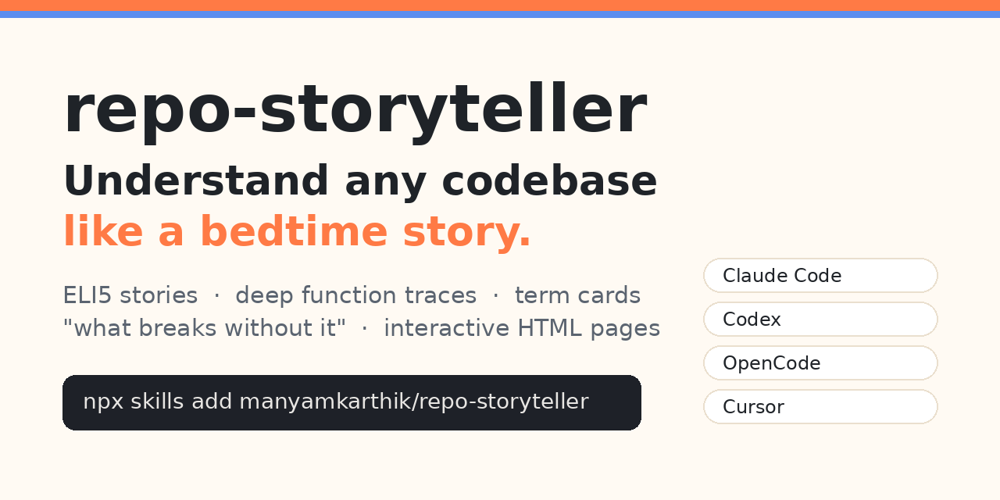

<p align="center">
  
</p>

<h1 align="center">📖 repo-storyteller: ELI5 codebase explainer skill</h1>

<p align="center">
  <b>Understand any codebase like a bedtime story, then learn the real engineering behind it.</b><br>
  An open-source Agent Skill for <b>Claude Code</b>, <b>OpenAI Codex</b>, <b>OpenCode</b>, <b>Cursor</b>, <b>Gemini CLI</b> and <b>GitHub Copilot</b>.
</p>

<p align="center">
  <a href="https://manyamkarthik.github.io/repo-storyteller/demo/startup-story.html"></a>
  <a href="https://github.com/manyamkarthik/repo-storyteller/stargazers"></a>
  <a href="LICENSE"></a>
  
</p>

<p align="center">
  <a href="https://manyamkarthik.github.io/repo-storyteller/demo/startup-story.html"><b>▶ See a real example page</b></a> ·
  <a href="#-install">Install</a> ·
  <a href="#-how-to-use-it">Usage</a> ·
  <a href="#-faq">FAQ</a>
</p>

---

Ever asked your AI agent to **explain a repo** and got a flat, forgettable summary? **repo-storyteller** turns your agent into a patient teacher. Ask it to explain a file, a function, a request flow, or a concept like *"what is a database index?"*, and you get:

- 🧸 **A kid-level story.** Your repo becomes a world (a restaurant, a factory, a library) with named characters that stay the same across every explanation.
- 🔍 **A deep, function-by-function trace.** It starts at a line (say `lifespan` in `app.py`), follows every call into your own functions **all the way down**, shows what goes in and what comes out at each step, then climbs back up. Every claim cites `file:line`.
- 🧩 **Term Cards** for every concept (DB index, connection pool, async, middleware, JWT, retries…):
  1. 📖 **The story**: the idea as a scene in the story world
  2. 🔧 **What it really is**: the real definition, and where it shows up in *your* code
  3. 🎯 **Why we need it**: the problem it solves here
  4. 💥 **What breaks without it**: what you'd actually see go wrong, with numbers where possible
- 🎢 **Built to keep you engaged:** short chapters, hooks and cliffhangers, "predict what happens" quizzes, a *you are here* breadcrumb and a *choose your next path* menu.
- 🌐 **An interactive HTML story page** with a clickable flow map, expandable nested traces, annotated code, a progress bar and dark mode.
- ✏️ **Excalidraw drawings**, if an Excalidraw MCP server is connected. Without one, it falls back to Mermaid diagrams.

## 👀 What the output looks like

The [`examples/tiny-notes-api`](examples/tiny-notes-api) folder holds a small FastAPI + SQLite app. We asked:

> *explain the lifespan in app.py like I'm 5 and trace every function it calls*

and the skill produced **[this story page](https://manyamkarthik.github.io/repo-storyteller/demo/startup-story.html)**. Here's a taste of one Term Card from it:

> **🧩 Database index**
> 📖 **The story:** a million notes on one long shelf. A visitor asks for "all of Kid's notes." Without the name-tag drawer, Sam reads *every single note*. With it, he opens the drawer at "K" and walks straight to the right spots.
> 🔧 **What it really is:** a sorted structure (a B-tree) that lets the database jump to matching rows. `db.py:24`
> 🎯 **Why we need it here:** the only endpoint, `GET /notes/{owner}`, filters by `owner`.
> 💥 **What breaks without it:** the query plan changes from `SEARCH … USING INDEX` to `SCAN notes`. Measured on 1M rows: **~53 ms vs ~0.02 ms per lookup**.

### Plain prompt vs repo-storyteller

| | "explain this code" | repo-storyteller |
|---|---|---|
| Depth | top-level summary | follows every call down to leaf functions and back up |
| Accuracy | often paraphrased | every claim cites `file:line` from code it actually read |
| Concepts | named, rarely explained | story → definition → why → **what breaks without it** |
| Staying power | gone when the chat scrolls | a saved HTML page plus a consistent story world |
| Engagement | wall of text | chapters, cliffhangers, quizzes, choose-your-path |

---

## 🚀 Install

### Any agent (recommended): `npx skills`

Uses the open [`skills`](https://github.com/vercel-labs/skills) CLI (Node.js 22+).

```bash
# Interactive: pick your agent(s)
npx skills add manyamkarthik/repo-storyteller

# Global install (every project) for a specific agent
npx skills add manyamkarthik/repo-storyteller -g -a claude-code
npx skills add manyamkarthik/repo-storyteller -g -a codex
npx skills add manyamkarthik/repo-storyteller -g -a opencode
npx skills add manyamkarthik/repo-storyteller -g -a cursor
npx skills add manyamkarthik/repo-storyteller -g -a gemini-cli
npx skills add manyamkarthik/repo-storyteller -g -a github-copilot

# Several agents at once
npx skills add manyamkarthik/repo-storyteller -g -a claude-code -a codex -a opencode
```

Leave out `-g` to install just for the current project.

### Claude Code: plugin marketplace

Inside Claude Code:

```
/plugin marketplace add manyamkarthik/repo-storyteller
/plugin install repo-storyteller@repo-storyteller
```

### One-line shell installer (no Node needed)

```bash
curl -fsSL https://raw.githubusercontent.com/manyamkarthik/repo-storyteller/main/install.sh | bash
```

This installs for every agent it finds on your machine. To pick specific ones:

```bash
curl -fsSL https://raw.githubusercontent.com/manyamkarthik/repo-storyteller/main/install.sh | bash -s -- claude codex opencode
```

### Manual install

Copy `skills/repo-storyteller/` into your agent's skills folder:

| Agent | Global (all projects) | Project only |
|---|---|---|
| Claude Code | `~/.claude/skills/` | `.claude/skills/` |
| Codex | `~/.codex/skills/` | `.agents/skills/` |
| OpenCode | `~/.config/opencode/skills/` | `.opencode/skills/` or `.agents/skills/` |
| Cursor | `~/.cursor/skills/` | `.agents/skills/` |
| Gemini CLI | `~/.gemini/skills/` | `.agents/skills/` |
| GitHub Copilot | `~/.copilot/skills/` | `.agents/skills/` |

```bash
git clone https://github.com/manyamkarthik/repo-storyteller.git
cp -r repo-storyteller/skills/repo-storyteller ~/.claude/skills/
```

Restart your agent after installing.

---

## 💬 How to use it

Just ask in plain words. The skill triggers on things like *explain*, *ELI5*, *walk me through*, *trace*, or *I don't get it*.

```text
explain this repo like I'm 5
explain the lifespan in app.py and trace every function it calls
what is a db index and why does models.py need one?
walk me through what happens when a user hits POST /chat
I don't get services/auth.py
```

You'll get a short teaser in chat, plus a story page at `.storyteller/<topic>.html` that opens in your browser. Each page ends with **"choose your next path"** buttons. Click one to copy the next prompt.

> 💡 Add `.storyteller/` to your `.gitignore`. It holds your story pages and `world.md`, which keeps the story world the same between sessions.

### Optional: Excalidraw

Connect an Excalidraw MCP server to your agent. The skill detects it automatically and draws:
- the call-stack journey (boxes and arrows, labeled with what data gets passed)
- the story-world map
- term scenes (e.g. *a shelf with a name-tag drawer vs without* for DB indexes)

---

## ❓ FAQ

<details>
<summary><b>Who is this for?</b></summary>

New engineers onboarding onto a codebase, students learning to code by reading real projects, developers inheriting legacy code, and anyone who reviews unfamiliar code.
</details>

<details>
<summary><b>Does it work with Codex, OpenCode and Cursor, or only Claude Code?</b></summary>

All of them. It follows the open Agent Skills `SKILL.md` standard, so any agent that supports skills can use it.
</details>

<details>
<summary><b>Which programming languages does it support?</b></summary>

Any language your agent can read: Python, TypeScript/JavaScript, Go, Rust, Java, C#, Ruby and more. The trace follows imports and function calls, whatever the language.
</details>

<details>
<summary><b>Does it change my code?</b></summary>

No. It only reads code. The only files it writes are the story pages and `world.md`, inside `.storyteller/`.
</details>

<details>
<summary><b>How is this different from codebase-onboarding or walkthrough skills?</b></summary>

Those produce maps and reference docs. repo-storyteller is built for **learning**: a narrative, a depth-first trace through every function on the path, and failure-scenario explanations for every concept.
</details>

---

## 🗂️ Repo layout

```
repo-storyteller/
├── skills/repo-storyteller/
│   ├── SKILL.md                 # the skill instructions
│   └── assets/template.html     # interactive story-page template
├── examples/tiny-notes-api/     # sample app used for the demo
├── docs/                        # GitHub Pages site + live demo page
├── .claude-plugin/              # Claude Code plugin + marketplace manifests
├── install.sh                   # curl | bash installer
├── LICENSE
└── README.md
```

## 🤝 Contributing

PRs are welcome, especially new story worlds, demos for other languages (Go, TypeScript, Rust), better term-card examples, and template improvements. Keep `SKILL.md` portable: no agent-specific tool names without a fallback.

If this helped you understand a codebase, please **⭐ star the repo** so others can find it.

## 📄 License

MIT © Karthik

<sub>Keywords: explain codebase, ELI5 code explainer, AI code explanation, Claude Code skill, Codex skill, OpenCode skill, Cursor skill, agent skills, SKILL.md, codebase onboarding, code walkthrough, understand a repository, learn to code, code tracing, software engineering concepts explained simply.</sub>
